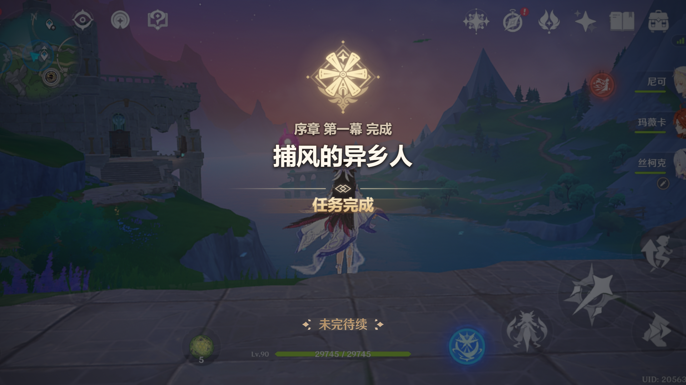

# 提瓦特任务影像工坊

一个无需后端的本地图片与视频合成网页。上传媒体后，可以编辑任务标题、调整遮罩和粒子效果，并导出带有任务完成风格叠层的 PNG 图片或动画视频。

当前版本：**1.0**（稳定版）



## 功能

- 上传本地图片或视频并即时预览。
- 编辑画面中的两行任务文字。
- 选择固定 `16:9` 输出或沿用原始媒体比例。
- 调整遮罩颜色、透明度和粒子强度。
- 在蒙德、璃月、稻妻、须弥、枫丹、纳塔和空月之歌七种任务徽记之间切换。
- 预览任务文字、徽记和粒子的统一动画时间线。
- 导出 PNG 图片，或在浏览器支持时导出 MP4/WebM 动画视频。
- 使用本地循环视频、毛玻璃界面和交互式 3D 景深粒子作为工作台皮肤。
- 编辑器皮肤与交互粒子不会进入最终导出画面。
- 用户上传的媒体只在当前浏览器内处理，不会上传到服务器。

## 在线部署

项目是纯静态网页，不需要构建步骤，可以直接部署到 GitHub Pages。

1. 将仓库推送到 GitHub。
2. 打开仓库的 `Settings > Pages`。
3. 在 `Build and deployment` 中选择 `Deploy from a branch`。
4. 选择 `main` 分支和 `/ (root)` 目录，然后保存。

部署完成后，GitHub 会在 Pages 设置页显示访问地址。背景视频已经压缩为约 4.74 MB 的 `assets/workbench-background.webm`，可以随仓库直接发布；本地原始 MP4 已由 `.gitignore` 排除。

## 本地运行

项目运行不需要安装第三方依赖。在项目目录启动静态文件服务器：

```powershell
python -m http.server 8000
```

然后访问：

```text
http://127.0.0.1:8000/index.html
```

不建议直接双击 `index.html`。浏览器对本地文件资源的安全限制可能导致图片、视频或导出模块加载失败。

## 使用方法

1. 点击“选择文件”，上传本地图片或视频。
2. 修改第一行和第二行任务文字。
3. 选择输出尺寸，调整遮罩颜色与透明度。
4. 选择任务徽记和粒子效果档位。
5. 在右侧画布检查效果，按需预览动画。
6. 选择图片或视频格式并导出结果。

## 项目结构

```text
.
├─ index.html                    页面结构
├─ js/                           页面脚本
│  ├─ renderer-core.js           渲染状态、尺寸和动画计算
│  ├─ script.js                  媒体加载、Canvas 绘制与导出
│  └─ editor-particles.js        编辑器 3D 景深粒子和背景视频控制
├─ css/
│  └─ styles.css                 工作台与响应式界面样式
├─ assets/                       徽记、装饰和轻量工作台背景
│  └─ preview/                   编辑器预览用的小尺寸徽记
├─ docs/
│  ├─ reference/                 视觉参考图
│  └─ specs/                     功能设计说明
├─ tests/                        Node.js 单元测试与 Edge 冒烟测试
│  └─ fixtures/                  冒烟测试上传用图片
├─ outputs/
│  └─ task-overlay-sample.png    README 展示图
└─ samples/                      本地示例与素材视频（不入库）
```

## 验证

基础测试需要本机已安装 Node.js：

```powershell
node --check js/editor-particles.js
node --check js/script.js
node tests\renderer-core.test.js
node tests\clean-assets.test.js
node tests\static-ui.test.js
node tests\emblem-loading.test.js
```

启动本地服务器后，可以运行 Edge 冒烟测试：

```powershell
node tests\edge-smoke.js
```

该测试会检查七种任务徽记的渲染结果，并刷新 `outputs/task-overlay-sample.png`。

## 视频导出说明

- PNG 导出保持当前静态画面布局。
- 上传视频后，网页会逐帧绘制背景媒体与任务动画，导出结果不包含源视频音轨。
- MP4 导出会优先使用浏览器 WebCodecs API，并在导出时从 CDN 加载 MP4 muxer。
- 浏览器不支持 MP4 或 CDN 不可用时，会自动回退为 WebM。

## 协议与素材声明

代码的使用、修改与分发遵循仓库中的 [LICENSE](LICENSE)。

仓库包含来源于或参考第三方作品的名称、视觉元素及素材。公开使用、再分发或用于商业场景前，请自行确认素材授权和适用规则。本项目与相关游戏开发商或发行商不存在官方关联。
